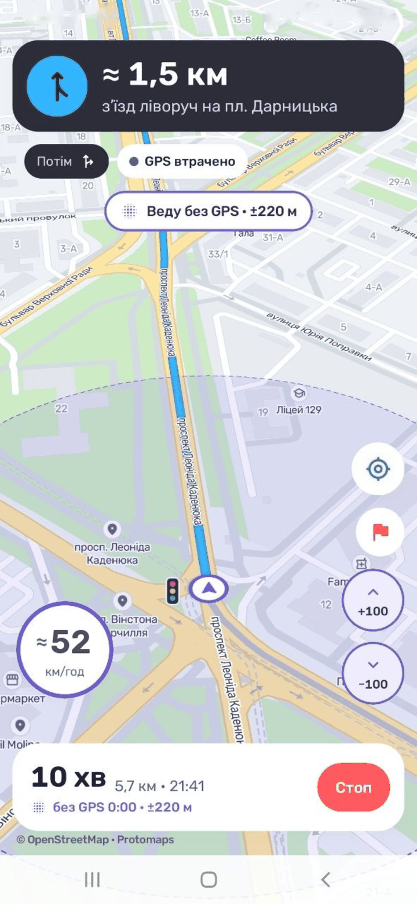
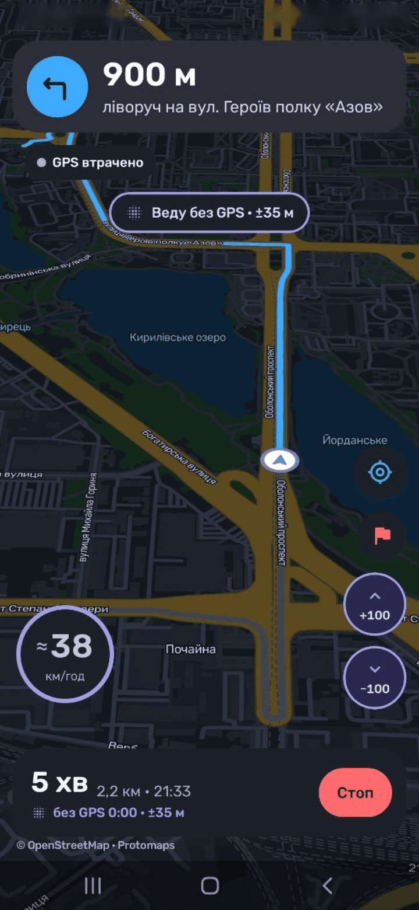
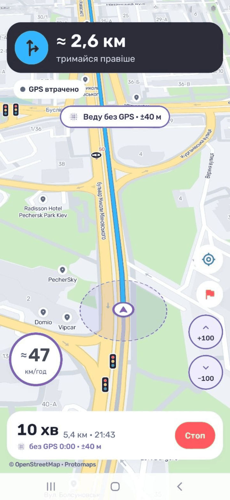

# Kurs — навігатор, що веде без GPS

Kurs — навігатор для України на Android, який не губиться, коли GPS глушать або підміняють. Без супутників він рахує шлях
за швидкістю (з OBD-адаптера авто або оцінкою без нього), поворотами з гіроскопа телефону й мобільними вишками і прив'язує
позицію до доріг. Карти всієї України — офлайн.

  
  
  

## Завантажити

**[Завантажити останню версію (kurs.apk)](https://github.com/AlexSmiian/kurs/releases/latest/download/kurs.apk)** — Android 10 і новіші.

Усі версії й історія змін — у [Releases](https://github.com/AlexSmiian/kurs/releases) і [CHANGELOG.md](CHANGELOG.md).
Застосунок сам повідомляє про нові версії й оновлюється з цього ж репозиторію.

Контрольна сума: у кожному релізі є `sha256.txt` — порівняй з `sha256sum kurs.apk` (Linux) або `shasum -a 256 kurs.apk` (macOS).

## Як встановити

Покрокова інструкція з картинками для Samsung, Xiaomi та інших — на сайті: **https://kurs-navigation.com/install**.

Коротко: завантаж `kurs.apk` у браузері телефону → відкрий файл → дозволь встановлення з цього джерела → «Встановити».

## Приватність

Координати, маршрути й адреси не залишають телефон без твоєї дії. Політика приватності — **https://kurs-navigation.com/privacy**,
умови використання — https://kurs-navigation.com/terms.

## Вихідний код закритий

Тут лише опис, історія змін і файли для завантаження — коду застосунку в цьому репозиторії немає (див. [LICENSE](LICENSE)).
Архіви «Source code (zip/tar.gz)» у кожному релізі GitHub додає сам — це копія цього репозиторію (README, CHANGELOG), не код застосунку.

## Підтримка

- **Telegram-група:** https://t.me/kurs_navigator — питання, ідеї, повідомлення про помилки і новини про бета-версії.
- **Із застосунку:** «Допомога» → «Не допомогло?». Можна додати запис поїздки — так ми швидше знайдемо причину.
- **Сайт:** https://kurs-navigation.com
